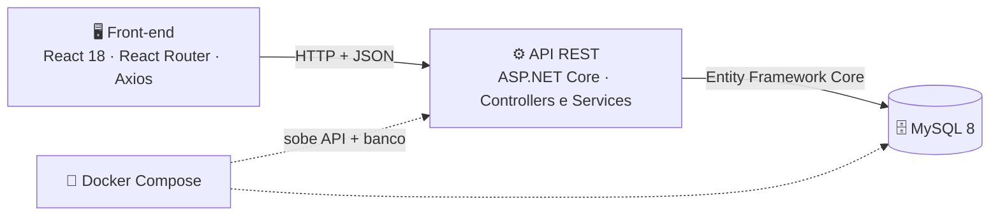
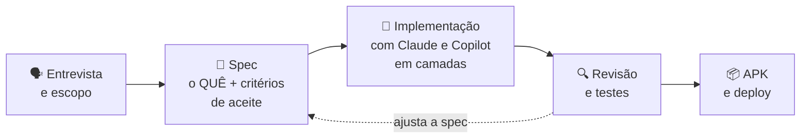

 

 

<!-- ===================== SOBRE MIM ===================== -->

 

Estudante de **Análise e Desenvolvimento de Sistemas** na UniPac Uberlândia (4º período, conclusão prevista para julho de 2027), em busca da primeira experiência profissional em desenvolvimento de software.

Trabalho **definindo escopo e especificações antes de implementar** e uso IA (Claude e GitHub Copilot) como ferramenta de implementação, com revisão e testes feitos por mim. Tenho base em Python/Django, React e Git/GitHub, e estou desenvolvendo um app para um **cliente real**, do levantamento de requisitos ao APK.

| | |
|:--|:--|
| 🎓 **Formação** | Análise e Desenvolvimento de Sistemas, curso noturno |
| 🎯 **Foco** | Back-end com Python/Django, front-end com React e apps mobile |
| 🧭 **Metodologia** | Spec-Driven Development: spec primeiro, código depois |
| 🔎 **Procuro** | Estágio ou vaga júnior em desenvolvimento (presencial em Uberlândia ou remoto) |

 

 

<!-- ===================== PROJETOS ===================== -->

 

<!-- ---------- STUDIO GE ---------- -->

  

### Studio GE

App Android de gestão para o **Studio Geração Energia**, feito para o dono e instrutor do studio. Nasceu no Projeto de Extensão do curso e, depois de uma **entrevista com o cliente**, deixou de ser um app para o aluno e virou uma ferramenta de trabalho do instrutor: alunos, avaliações físicas, evolução, treinos e financeiro em um só lugar.

<table>
  <tr>
    <td align="center" width="25%"> <b>Alunos</b></td>
    <td align="center" width="25%"> <b>Evolução</b></td>
    <td align="center" width="25%"> <b>Treino</b></td>
    <td align="center" width="25%"> <b>Financeiro</b></td>
  </tr>
</table>

> As telas usam dados fictícios gerados por um comando de seed; nenhum dado real de aluno está no repositório.

**O que o app faz**

- 📏 **Avaliações e evolução:** 12 métricas por avaliação, IMC calculado automaticamente, gráfico por métrica e tabela comparativa entre avaliações
- 🏋️ **Treinos:** catálogo de exercícios por grupo muscular, séries, repetições, carga e adaptações por aluno
- 💰 **Financeiro:** mensalidades geradas por mês, pagamento em um toque, despesas, saldo, inadimplência e gráfico de 6 meses
- 🗂️ **Perfis de trabalho:** Academia, Personal e Pessoal, cada um com seus próprios dados

**Engenharia por trás**

- API REST em **Django REST Framework** com regras de negócio no back-end (IMC, status de pagamento e saldo são calculados, nunca digitados) e testes automatizados
- App em **React Native + Expo (TypeScript)**, distribuído como **APK** via EAS Build, com o back-end publicado na nuvem
- **22 specs** em `specs/` guiando cada funcionalidade e um `CLAUDE.md` com as convenções do projeto (por exemplo, dinheiro sempre em `DecimalField`)
- Pensado para quem não é da área de tecnologia: poucos passos por tela, áreas de toque de 44px e nenhum estado indicado só por cor

 

<!-- ---------- TAREFAS EXPRESS ---------- -->

### TarefasExpress

Aplicação para **organizar tarefas em grupos** (casa, trabalho, escola), com convite de membros, responsáveis, prioridade, prazo e comunicação dentro do próprio grupo. É a base do meu TCC.

- 👥 **Grupos e convites:** cada grupo tem seus membros, cargos e tarefas
- ✅ **Tarefas completas:** prioridade, prazo, responsáveis, categorias, comentários e anexos
- 💬 **Comunicação:** chat do grupo e notificações
- 📊 **Relatórios:** visão do andamento das tarefas

 

 

<!-- ===================== STACK E FERRAMENTAS ===================== -->

 

| | |
|:--|:--|
| **Uso no dia a dia** |         |
| **Já usei em projetos** |         |
| **IA e fluxo de trabalho** |      |

Também estudo Java Web (Servlet, JSP, JDBC) e SQL na faculdade.

 

<!-- ===================== COMO EU TRABALHO ===================== -->

 

Uso **Spec-Driven Development (SDD)**: primeiro eu decido *o quê* o software precisa fazer, depois a IA ajuda no *como*. Aprendo e pratico o método com [BMAD-METHOD](https://github.com/bmad-code-org/BMAD-METHOD), [spec-kit](https://github.com/github/spec-kit) e [tech-leads-club/agent-skills](https://github.com/tech-leads-club/agent-skills).

- **Spec antes do código:** nenhuma funcionalidade começa sem uma spec com critérios de aceite
- **Contexto para a IA:** cada projeto tem um `CLAUDE.md` com convenções e regras, para a IA seguir o mesmo padrão sempre
- **Mudanças pequenas:** uma funcionalidade por vez, em camadas (model, migration, API, tela)
- **A revisão é minha:** leio o que a IA gerou, rodo os testes e valido com o uso real

 

 

<!-- ===================== CONTATO ===================== -->

 

Estou buscando **estágio ou vaga júnior** em desenvolvimento de software. Fique à vontade para olhar os projetos acima e entrar em contato.

 

<!-- Descomente e preencha para adicionar mais formas de contato:

-->

  

Feito com código e um toque de nostalgia Aero

