<!-- ===================== BANNER ===================== -->

 

<!-- ===================== TYPING ===================== -->

  

<!-- ===================== TERMINAL ===================== -->

 

 

<!-- ===================== SOBRE MIM ===================== -->

 

Estudante de **Análise e Desenvolvimento de Sistemas** em busca da primeira experiência em desenvolvimento de software. Defino escopo e specs antes de implementar e uso IA como ferramenta, com revisão e testes feitos por mim.

| | |
|:--|:--|
| 🎓 **Formação** | ADS, 4º período, curso noturno |
| 🎯 **Foco** | Python/Django, React e apps mobile |
| 🧭 **Metodologia** | Spec-Driven Development: spec primeiro, código depois |
| 🔎 **Procuro** | Estágio ou vaga júnior, em Uberlândia ou remoto |

 

 

<!-- ===================== STACK ===================== -->

 

  

 

 

 

<!-- ===================== PROJETOS ===================== -->

 

<table>
<tr>
<td width="50%" valign="top">

### 🏋️ Studio GE
App Android de gestão para um studio de treino real: alunos, avaliações físicas, evolução, treinos e financeiro.

`React Native` `Expo` `Django REST` `SDD`

</td>
<td width="50%" valign="top">

### ✅ TarefasExpress
Gestão de tarefas em grupos (casa, trabalho, escola), com responsáveis, prazos e chat. Base do meu TCC.

`React` `ASP.NET Core` `MySQL` `Docker`

</td>
</tr>
</table>

 

 

<!-- ===================== RODAPÉ ===================== -->

  

Feito com código e um toque de nostalgia Aero

